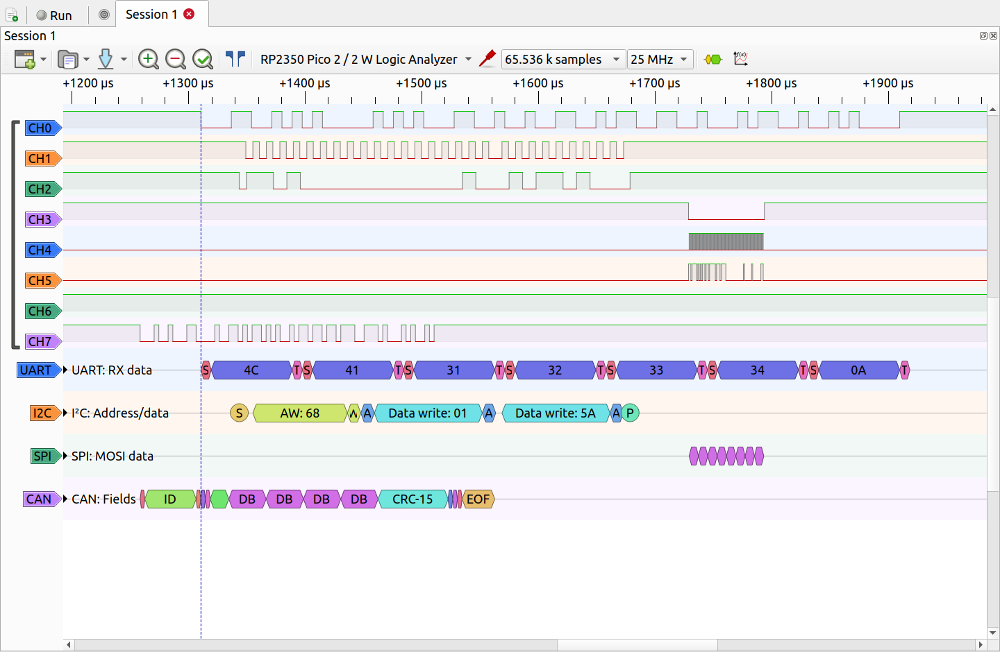
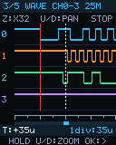
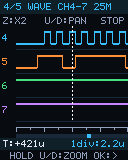
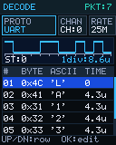

# TEST REPORT — QA v2,18/11/2026

Run đầy đủ: [qa-v2-20261118-015654](../results/qa-v2-20261118-015654/). Kết quả: **28 PASS, 0 FAIL, 2 BLOCKED, 3 NOT-VERIFIED**.

Exit0 nghĩa không có FAIL đã thực thi. Sản phẩm **chưa được chứng minh đạt toàn bộ đề tài** do thiếu kiểm chứng front-end/bảo vệ/BOM và fixture đủ8 nguồn. Các đường số, GUI và demo đạt trong cấu hình thử.

Môi trường/source/binary hash: [manifest](../results/qa-v2-20261118-015654/manifest.json); [CSV](../results/qa-v2-20261118-015654/summary.csv); [kết quả máy đọc](../results/qa-v2-20261118-015654/summary.json). Kế hoạch: [TEST-PLAN-v2](TEST-PLAN-v2.md).

## 1. Bảng kết quả theo case

| ID | Mục tiêu | Điều kiện | Kỳ vọng | Thực tế / bằng chứng | Verdict |
|---|---|---|---|---|---|
|A0|Compile the production C oracle bridge|offline compiler|build succeeds with sanitizers|ASan/UBSan bridge built from production decoder/autodetect sources [toàn bộ số liệu và files](../results/qa-v2-20261118-015654/cases/A0.json)|PASS|
|A1|Independent .sr four-bus oracle|synthetic 25 MHz;UART115200,I2C100k,SPI100k,CAN250k|all bytes/address/ID/DLC match|{"UART": [76, 65, 49, 50, 51, 52, 10], "I2C": [1, 90], "SPI": [222, 173, 190, 239, 0, 1, 2, 3], "CAN": [222, 173, 190, 239]} [toàn bộ số liệu và files](../results/qa-v2-20261118-015654/cases/A1.json)|PASS|
|A2|Byte-level C versus sigrok differential|exact A1 byte stream;real firmware C|100% fields/bytes identical|{"same_file": "A1-four-protocols.sr", "firmware": {"UART": [76, 65, 49, 50, 51, 52, 10], "I2C": [1, 90], "SPI": [222, 173, 190, 239, 0, 1, 2, 3], "CAN": [222, 173, 190, 239]}, "... [toàn bộ số liệu và files](../results/qa-v2-20261118-015654/cases/A2.json)|PASS|
|A3|Decoder adversarial safety/determinism|34 bounded vectors;ASan/UBSan;6s/process|0 crash,0 hang;identical repeat outputs|{"vectors": 32, "runs": 64, "sanitizer_errors": 0, "parity_validation": "unsupported: firmware is 8N1; this case verifies safety only"} [toàn bộ số liệu và files](../results/qa-v2-20261118-015654/cases/A3.json)|PASS|
|A4|Autobaud Q16 width accuracy|3rates x4bauds;fractional widths;independent alternating UART|absolute error<2%|{"cases": 12, "max_error_percent": 0.0953950221142863} [toàn bộ số liệu và files](../results/qa-v2-20261118-015654/cases/A4.json)|PASS|
|A5|AUTO moved-channel and noise rejection|4 protocols x fixed/moved plus8 noise seeds|correct protocol and map;noise=>no bus|{"bus_cases": 8, "noise_cases": 8, "wrong_guesses": 0} [toàn bộ số liệu và files](../results/qa-v2-20261118-015654/cases/A5.json)|PASS|
|B1|Frequency, duty and quantization jitter|known1 kHz PWM on GPIO26;1/5/25 MHz|frequency error<0.5%;record period/duty/jitter|{"reference": "ESP32 LEDC timer2 on existing CH0 wire;not external calibration", "measurements": [{"periods": 261, "period_samples_mean": 999.992337164751, "frequency_hz": 1000.... [toàn bộ số liệu và files](../results/qa-v2-20261118-015654/cases/B1.json)|PASS|
|B2|Actual UART bit-width metrology|UART115200;1/5/25 MHz;unit-width run clusters|mean<2%;25 MHz mean<1sample error|[{"rate": 1000000, "expected_samples": 8.680555555555555, "mean_samples": 8.666666666666666, "count": 21, "error_percent": -0.16000000000000458, "jitter_pp_samples": 1, "jitter_... [toàn bộ số liệu và files](../results/qa-v2-20261118-015654/cases/B2.json)|PASS|
|B3|All-channel edge trigger geometry|8 channels x2polarities;25 MHz;65536/pre32768|exact32768±1 and correct previous/current bit|Tested 14 polarities; no external transitions on CH[6]; see B3-edge-results.json [toàn bộ số liệu và files](../results/qa-v2-20261118-015654/cases/B3.json)|BLOCKED|
|B4|Pattern/manual and never-match recovery|CH0high pattern;UART-off driven-high CH0 opposite pattern;400 ms host timeout|match correct;manual no trigger;subsequent capture valid|matching pattern and manual valid;never-match host timeout+HELLO recovery valid [toàn bộ số liệu và files](../results/qa-v2-20261118-015654/cases/B4.json)|PASS|
|B5|Buffer and pretrigger boundary clamp|pre0/half/>half;count262144triggered|count<=131072;pre<=half;exact index;no deadlock|[{"request_count": 65536, "request_pre": 0, "info": {"rate": 25000000, "count": 65536, "trigger_index": 0, "pretrigger": 0, "channels": 8, "unit": 1, "mask": 255, "flags": 1}, "... [toàn bộ số liệu và files](../results/qa-v2-20261118-015654/cases/B5.json)|PASS|
|B6|Repeated sparse trigger|UARTburst100 ms;100 consecutive captures|100/100;index32768;eachARM-to-completion<1s|{"captures": 100, "max_seconds": 0.49939930000255117, "host_peak_rss_kib": 28776} [toàn bộ số liệu và files](../results/qa-v2-20261118-015654/cases/B6.json)|PASS|
|B7|Real four-bus decode rate matrix|4 protocols x3rates;SPI100k at1 MHz;CAN250k|expected complete bytes;device and sigrok agree|{"cases": 12, "all_expected_bytes": true} [toàn bộ số liệu và files](../results/qa-v2-20261118-015654/cases/B7.json)|PASS|
|B8|Independent8-channel mapping/crosstalk/skew|current bus wiring;reference all8not available|all8 driven by known independent waveforms;no undocumented rewiring|Current wiring edge counts [126, 168, 42, 6, 384, 72, 0, 98]; distinct8-channel reference/common-edge skew source is not connected [toàn bộ số liệu và files](../results/qa-v2-20261118-015654/cases/B8.json)|BLOCKED|
|C1|10s four-protocol streaming|1 MHz RLE;SPI100k;CAN250k|0 drop;counts/duration<0.1%;4 bus oracle|{"rate": 1000000, "samples": 10000064, "received_samples": 10000064, "mask": 255, "channels": [0, 1, 2, 3, 4, 5, 6, 7], "dropped": 0, "seconds": 10.105293418004294, "rle": true,... [toàn bộ số liệu và files](../results/qa-v2-20261118-015654/cases/C1.json)|PASS|
|C2|Raw USB streaming|500kHz5s;8bit/sample|0 drop;counts<0.1%;UART correct|{"rate": 500000, "samples": 2500028, "received_samples": 2500028, "mask": 255, "channels": [0, 1, 2, 3, 4, 5, 6, 7], "dropped": 0, "seconds": 5.055765256998711, "rle": false, "b... [toàn bộ số liệu và files](../results/qa-v2-20261118-015654/cases/C2.json)|PASS|
|C3|Continuous five-minute lossless soak|1 MHz RLE;real bus traffic;>=300s|0 drop/seq/CRC/fault;readable .sr;fresh capture|{"rate": 1000000, "samples": 299999984, "received_samples": 299999984, "mask": 255, "channels": [0, 1, 2, 3, 4, 5, 6, 7], "dropped": 0, "seconds": 300.0779504009988, "rle": true... [toàn bộ số liệu và files](../results/qa-v2-20261118-015654/cases/C3.json)|PASS|
|C4|Graceful stop and killed-host recovery|SIGINT and SIGKILL injected into real active host|SIGINT tail verified;after each fault capture valid|[{"signal": "sigint", "exit": 0, "recovered": {"rate": 1000000, "count": 1031, "trigger_index": 4294967295, "pretrigger": 0, "channels": 8, "unit": 1, "mask": 255, "flags": 0}},... [toàn bộ số liệu và files](../results/qa-v2-20261118-015654/cases/C4.json)|PASS|
|C5|Host backpressure and UI recovery|raw500k;square125k;PC read stall800 ms|explicitINVALID/dropcounts;afterdrain nextscreen responds|{"stream": {"rate": 500000, "samples": 2500020, "received_samples": 2305525, "mask": 255, "channels": [0, 1, 2, 3, 4, 5, 6, 7], "dropped": 194495, "seconds": 5.061809046004782, ... [toàn bộ số liệu và files](../results/qa-v2-20261118-015654/cases/C5.json)|PASS|
|C5b|USB send deadline under prolonged host stall|raw500k;4s unread interval exceeds3s deadline|explicitINVALID;no permanent hang;freshcapture<15s|{"stream": {"rate": 500000, "samples": 491649, "received_samples": 491649, "mask": 255, "channels": [0, 1, 2, 3, 4, 5, 6, 7], "dropped": 0, "seconds": 5.015435927001818, "rle": ... [toàn bộ số liệu và files](../results/qa-v2-20261118-015654/cases/C5b.json)|PASS|
|C6|Unsupported rates cannot silently succeed|2 MHz/5 MHz stream requests|explicit error;no invalid VALID file|[{"rate": 2000000, "exit": 2}, {"rate": 5000000, "exit": 2}, {"device_rate": 5000000, "rejection": "ANALYZE error from device"}] [toàn bộ số liệu và files](../results/qa-v2-20261118-015654/cases/C6.json)|PASS|
|D1|Device capability discovery|actual rp2350-la over USB CDC|correct name8 channels/8rates|Driver functions:     Logic analyzer Scan options:     conn rp2350-la - RP2350 Pico 2 / 2 W Logic Analyzer LAR2 v1 with 8 channels: CH0 CH1 CH2 CH3 CH4 CH5 CH6 CH7 Supported con... [toàn bộ số liệu và files](../results/qa-v2-20261118-015654/cases/D1.json)|PASS|
|D2|Driver snapshot and PC decoder E2E|25MHz65536;edgefall;pre50%;realESP32|CRCverified and4 bus expected data|{"file": "D2/capture.sr", "trigger": "CH0", "rate": 25000000, "count": 65536, "decoder_oracle": "UART/I2C/SPI/CAN payload checked by demo.capture_driver"} [toàn bộ số liệu và files](../results/qa-v2-20261118-015654/cases/D2.json)|PASS|
|D3|PulseView live acquisition and visible annotations|4configured GUIdecoders;native settings;TFT2s/page|8waveforms;4visible expected decoder outputs;GUI+root PNG|{"summary": "PASS", "gui": "PASS_LIVE", "config": {"pretrigger": 0.5, "samplerate": 25000000, "samples": 65536, "trigger_slope": "falling", "trigger_source": "CH0"}, "annotation... [toàn bộ số liệu và files](../results/qa-v2-20261118-015654/cases/D3.json)|PASS|
|D4|Sigrok session metadata and binary layout|actual D2.sr;8 channels|exact probe names/rate/65536one-byte samples|{"probes": 8, "unitsize_derived": 1, "binary_bytes": 65536, "rate": 25000000} [toàn bộ số liệu và files](../results/qa-v2-20261118-015654/cases/D4.json)|PASS|
|D5|Parallel decoder session lifecycle regression|4threads x10create/start/send/destroy cycles|0sessionlookupfailures;annotations generated|sessions=40 failures=0 annotations=2640 [toàn bộ số liệu và files](../results/qa-v2-20261118-015654/cases/D5.json)|PASS|
|E1|12VDC/200Vpulse protection|source inventory and evidence review;no safe pulse fixture|rated schematic plus measured clamp behavior required|CHƯA KIỂM CHỨNG BẰNG ĐO:missing schematic/component ratings and safe measured12V/200V front-end evidence [toàn bộ số liệu và files](../results/qa-v2-20261118-015654/cases/E1.json)|NOT-VERIFIED|
|E2|Budget conformity|priced BOM inventory|quantity*price total<=450000 VND with traceable prices|Historical4-channel/OLED estimate sums338000-453000 VND;current8-channel/TFT as-built BOM/receipts missing;<=450000not verified [toàn bộ số liệu và files](../results/qa-v2-20261118-015654/cases/E2.json)|NOT-VERIFIED|
|E3|Practical operating envelope|code+measured digital paths;analog fixture absent|state40 ns/buffer/USB limits;measure loading/voltage before compatibility claim|Digital limits are derived/tested;analog loading,5V compatibility and absolute calibration lack measurements;see E3-practical-limits.json [toàn bộ số liệu và files](../results/qa-v2-20261118-015654/cases/E3.json)|NOT-VERIFIED|
|F1|50 consecutive independent snapshots|manual1MHz65536;sameDevice session|50/50CRC/sequence/metadata correct|{"captures": 50, "max_seconds": 0.3204650589977973, "host_peak_rss_kib": 29532, "limitation": "No MCU heap watermark API;successful repetition does not prove absence of all leaks"} [toàn bộ số liệu và files](../results/qa-v2-20261118-015654/cases/F1.json)|PASS|
|F2|Mid-session hardware USB reset/recovery|SDK1200baud reset into ROMbootloader;reload currentUF2|old acquisition invalid;driver/host reconnect and capture valid|actual USB reenumeration during active driver capture;error not marked valid;reflash/reconnect capture passed [toàn bộ số liệu và files](../results/qa-v2-20261118-015654/cases/F2.json)|PASS|
|F4|Non-destructive flash/golden/diff regression|existing flash session;3sample comparison;invalid header;noerase|byte-exact replay;DIFF preserves golden;invalidLOAD retains RAM|{"slot": 1, "count": 10000, "crc32": "e2e18d09", "odd_length": 3, "invalid_headers_rejected": [0], "flash_writes": 0, "scope": "load/replay/golden/diff checked;new save/erase sk... [toàn bộ số liệu và files](../results/qa-v2-20261118-015654/cases/F4.json)|PASS|
|F3|Full regression gate|oldsoftware tests+realESP32test+currentQAresults|no executedFAIL;never relabel BLOCKED as PASS|legacy suite and4 protocol x snapshot/streaming PASS;new runner checks all executed cases;blocked criteria remain explicit [toàn bộ số liệu và files](../results/qa-v2-20261118-015654/cases/F3.json)|PASS|

## 2. Số đo timing

Reference: LEDC ESP32 trên dây CH0 hiện có, không phải oscillator đã hiệu chuẩn. Jitter gồm quantization và sai khác hai clock, chưa tách jitter analog.

| Sample rate | Frequency đo (Hz) | Sai số (%) | Duty | Period mean (sample) | Jitter p-p/RMS (sample) |
|---|---:|---:|---:|---:|---:|
|1000000|1000.007663|0.000766|0.499996|999.992337|1.000 / 0.087202|
|5000000|1000.007692|0.000769|0.500000|4999.961538|1.000 / 0.192308|
|25000000|1000.004000|0.000400|0.500002|24999.900000|1.000 / 0.300000|

| Sample rate | UART bit lý thuyết | Mean đo | Sai số (%) | Jitter p-p/RMS (sample) |
|---|---:|---:|---:|---:|
|1000000|8.680556|8.666667|-0.160000|1.000 / 0.471405|
|5000000|43.402778|43.523810|0.278857|1.000 / 0.499433|
|25000000|217.013889|217.000000|-0.006400|2.000 / 0.617213|

Autobaud offline:12 tổ hợp; sai số lớn nhất **0.095395%**. Trigger100lần: max ARM→complete **0.499399s**; index32768. CH6không có nguồn cạnh nên B3chỉ kiểm14 polarity, không phải16/16.

## 3. Streaming và recovery

| Case | Rate | Số mẫu PC / Pico | Drop | Device duration (s) | Rate thực (sample/s) | Host peak RSS (KiB) |
|---|---:|---:|---:|---:|---:|---:|
|C1|1000000|10000064 / 10000064|0|10.000067|999999.700002|16596|
|C2|500000|2500028 / 2500028|0|5.000057|499999.900001|16384|
|C3|1000000|299999984 / 299999984|0|299.999987|999999.990000|16484|

C3 có **613,403block**, tương ứng nhiều lần sequenceu16wrap; CRC/counter/offset đều qua. Offsetu32qua2^32mới kiểm unit, chưa soak>71 phút.

SIGINT giữ tail và counter; SIGKILL/USB reset đều phục hồi bằng capture mới. Stall800 ms gây gap có đếm, file INVALID. Stall4s vượt deadline3s có thể cắt frame, host phải báo INVALID rồi HELLO/capture lại; không nhận 0 drop của một capture thiếu counters là thành công.

C1/C2 cố ý thu snapshot ngay trước stream: regression cho IRQ snapshot còn pending. Trước fix, C1từng có10.065.540 mẫu/10,000015s, thừa chính xác một slot64 KiB dù counters hai đầu khớp. Fix xóa pending IRQ; receiver kiểm thêm rate/duration để bắt trường hợp hai counter cùng sai.

Các phép thử capacity trước đó cho thấy dense/raw1 MHz vượt USB, mất hàng chục triệu mẫu/60s. Đó là INVALID/CAPACITY_LIMIT, không phải thông số lossless của sản phẩm. Dùng RLE cho traffic nén được hoặc raw500 kHz.

## 4. Ảnh bằng chứng thật









Ảnh desktop X11: [D3-root.png](../results/qa-v2-20261118-015654/D3-root.png). Ảnh TFT là framebuffer đọc trực tiếp từ Pico sau khi flushSPI; không phải camera panel hay mockPC. Mỗi màn demo giữ2 giây.

## 5. Defect và quyết định review

Danh sách root cause, fix, regression và việc còn mở ở [OPINION](../OPINION.md). Các run trước sửa được giữ, không sửa verdict cũ. Những điểm quan trọng:

- High,đã sửa: STOP tail bị bỏ, stale DMA IRQ tạo64 KiB giả, triggerlate lệch pre, GUI session race.
- Medium,đã sửa: autobaud idle-prefix, AUTO I2C→CAN, ESP32 LEDC/pin conflict, UART-off trong burst, console/config races, TFTedge/zoom/rate.
- Chưa khép: CAN CRC/error semantics, UART parity, SPI mode/MISO đầy đủ, analog front-end và calibration. Không dùng tập positive vectors để nhận các mục này đã đạt.
- Lỗi harness đã sửa: CH6floating không làm nguồn impossible-pattern; bài cuối dùng UART-off driven-high. Activity checkSPIhạ100k để tránh alias SCK1 MHz tại sample1 MHz.
- Save/eraseflash chưa thử lại trên dữ liệu mới vì hai slot có nội dung. F4kiểm read-only replay, golden3 sample, DIFFkhông phá golden và invalidLOADkhông đổiRAM.

## 6. Đánh giá tiêu chí đề tài

| Tiêu chí | Kết luận |
|---|---|
|8 channel /25 MHz capture số|Capabilities và PIO/capture xác minh; nguồn ngoài CH6/skew/crosstalk còn BLOCKED|
|PCwaveform/decode4 bus|PASS trong PulseView live và sigrok oracle|
|Streaming thực dụng|PASS1 MHz RLE5 phút với traffic đã thử; raw500 kHzPASS; không claim dense/raw1 MHz|
|TFT/UI|Ảnh framebuffer, pixel/state/USB controls đã kiểm; tiếp điểm/camera panel chưa nghiệm thu|
|Bảo vệ12VDC/200Vpulse|CHƯA KIỂM CHỨNG BẰNG ĐO|
|BOM≤450000 VND|NOT-VERIFIED:plan4channel/OLEDkhácas-built; tổng lịch sử338000–453000|
|Absolute timing/5V/inputload|NOT-VERIFIED:thiếu reference và fixture analog|

**Kết luận:** prototype đạt các đường số/demo được kiểm; **chưa đủ bằng chứng đạt toàn bộ đề tài hoặc LAphổ dụng**. Không có FAIL trong run cuối không biến BLOCKED/NOT-VERIFIED thành PASS.

## 7. Chạy lại và trình diễn

```bash
bash tests/test_qa_offline.sh
python3 tests/run_qa.py
bash scripts/test.sh
python3 tests/test_esp32_link.py
DISPLAY=:0 bash scripts/demo.sh
```

Full QA có soak300s và reset USB. Chỉ một chương trình điều khiển Pico ở mỗi thời điểm. Demo được chạy cuối để giữ PulseView mở; mặc định mỗi màn TFT2 giây.


Ghi chú A3: nhãn conditions ghi34 là typo của harness; số thực ở actual là32vector/64lượt. Không có34vector được nhận là đã chạy.


## Demo mặc định chốt cuối

Đã chạy lại bằng đúng `DISPLAY=:0 bash scripts/demo.sh` (không thêm option):
**PASS / PASS_LIVE**, tự đóng GUI demo trước và giữ GUI mới mở. Mỗi màn TFT mặc định2giây.
Bằng chứng: [summary](../results/demo-final/summary.json), [terminal](../results/demo-final/terminal.log),
[ảnh GUI](../results/demo-final/pulseview.json.png), [desktop](../results/demo-final/desktop.png).
