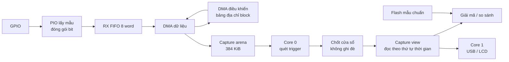

# Tối ưu RAM, FIFO, DMA và kiến trúc capture cho Logic Analyzer RP2350

**Có thể tối ưu đáng kể, nhưng code hiện tại cần sửa một số lỗi trước khi tăng buffer hoặc tốc độ.** Kiến trúc mình đề xuất là: **RAM capture 384 KiB, ghi vòng theo block bằng DMA, trigger đọc các block đã hoàn tất, rồi chốt dữ liệu để giải mã và truyền USB.**

Mình đã rà đúng commit `415ddc8` của nhánh `feature/trigger-v2` và chạy thử riêng một số hàm bằng AddressSanitizer/UndefinedBehaviorSanitizer trên PC. **Chưa thay đổi firmware trong dự án; những kiểm tra này chưa thay thế thử nghiệm trên Pico.**

**1. Trước hết, cần phân biệt số mẫu và thời gian đo**

Với buffer cố định:

\[
T_{\text{capture}}=\frac{N_{\text{samples}}}{f_s}
=\frac{8B_{\text{RAM}}}{b_{\text{sample}}\times f_s}
\]

Trong đó `b_sample` là số bit thực sự lưu cho một thời điểm.

Tăng tốc độ lấy mẫu **không tự làm số mẫu tăng** nếu buffer giữ nguyên; nó làm thời gian chứa trong buffer giảm. Muốn giữ nguyên thời gian, nhóm phải tăng bộ nhớ hoặc giảm lượng dữ liệu lưu.

**Với 8 kênh bất kỳ, code đang lưu 1 byte/mẫu là đã gọn.** Không có cách nén luôn đảm bảo nhỏ hơn cho mọi tín hiệu. Những chỗ có thể cải thiện là:

- Dành thêm SRAM cho capture.
- Đóng gói ít bit hơn khi đo ít kênh.
- Dùng buffer vòng để giữ đúng khoảng quanh trigger.
- Bỏ các bản sao không cần thiết.
- Nén có điều kiện đối với tín hiệu ít thay đổi.

**2. Những lỗi và khoảng mất dữ liệu đang có**

Các vị trí dưới đây thuộc [main.c của commit đã kiểm tra](https://github.com/dinhanh7/Logic_Analyzer_20261/blob/415ddc81b9094c90686c97922be965f48bb98047/PulseView-custom/firmware/main.c).

| Vấn đề | Hậu quả |
|---|---|
| `flash_load_session()` kiểm tra theo dung lượng slot Flash thay vì buffer RAM | Header lỗi có thể gây ghi vượt RAM |
| `produced_samples()` luôn trừ 64 | Cuối buffer không được xử lý đầy đủ |
| Hết buffer thì `start_capture()` lại | Có khoảng ngừng lấy mẫu; mất lịch sử trước trigger |
| UART trigger không giữ trạng thái giữa lượt quét | Bỏ lỡ frame qua ranh giới |
| `DIFF` dùng lại `golden_samples` | Làm thay đổi mẫu chuẩn |
| Compare theo word nhưng báo theo sample | Sai vị trí và dung sai |
| Compare chỉ xét độ dài chung | Có thể báo MATCH khi hai phiên dài khác nhau |
| Ép `win_base` sang `uint32_t *` | Có truy cập lệch căn chỉnh |
| Không có trạng thái “capture hợp lệ” riêng | Có thể phân tích dữ liệu chưa hoàn chỉnh |

Mình đã tái hiện các trường hợp sau bằng các hàm tách trực tiếp từ firmware:

```text
LOAD 262145 byte → ghi vượt buffer 262144 byte.
Sai khác ở sample 3 → báo sample 0.
DIFF → thay đổi golden; COMPARE sau đó có thể báo MATCH sai.
Phiên 32 mẫu và golden 16 mẫu → vẫn có thể báo MATCH.
UART quét nguyên frame → thấy; chia qua hai lượt quét → không thấy.
```

Hai lỗi cần giải thích rõ hơn:

**Lỗi 64 mẫu cuối:** khi DMA hoàn tất, hàm hiện chỉ trả tối đa:

```text
262144 − 64 = 262080 mẫu
```

Trong khi điều kiện chốt cửa sổ đầy đủ có thể cần tới `262144`. Vì vậy, **capture có trigger với count bằng toàn buffer không thể hoàn tất cửa sổ đó theo logic hiện tại**. Khi DMA đã hoàn thành an toàn, phải công nhận toàn bộ dữ liệu hoàn tất, không tiếp tục trừ một lượng cố định.

**Khoảng mất dữ liệu khi re-arm:** code hiện dừng, cấu hình lại PIO/DMA rồi chạy lại. Khoảng giữa hai lần thu không được ghi nhận. Một sự kiện chỉ xảy ra một lần có thể rơi vào khoảng này, hoặc nằm cuối buffer nhưng thiếu dữ liệu sau trigger và bị bỏ qua.

Do đó, câu “không mất mẫu” chỉ có thể áp dụng cho **một capture đã được xác minh**, chưa thể áp dụng cho toàn bộ thời gian chờ trigger.

Ngoài ra, `send_frame()` có thể chờ tới vài giây khi PC không nhận dữ liệu. Trong thời gian chờ đó, firmware không quay lại parser lệnh để xử lý `ABORT` ngay.

**3. FIFO và queue hiện tại thực chất là gì?**

Luồng hiện tại là:

```text
GPIO → PIO ISR → PIO RX FIFO → DMA → samples[]
                                      ↓
                               CPU đọc / xử lý
                                      ↓
                              TinyUSB CDC → PC
```

Ở đây, **ISR của PIO là Input Shift Register**, không phải hàm phục vụ ngắt.

| Thành phần | Hiện trạng |
|---|---|
| Thanh ghi dịch PIO | Gom 4 mẫu 8 bit thành một word 32 bit |
| PIO RX FIFO | Mặc định 4 word, tức 16 byte |
| PIO TX FIFO | Dùng khi khởi động để nạp bộ đếm X |
| Buffer `samples[]` | Mảng tuyến tính 256 KiB |
| Queue block hoàn tất | Chưa có |
| Queue lệnh ứng dụng | Chưa có; parser gọi xử lý trực tiếp |
| Core thứ hai | Có include thư viện, nhưng chưa được khởi chạy |

PIO cho phép ghép thành **RX FIFO 8 word = 32 byte**. Tuy nhiên, khi ghép như vậy, TX FIFO không còn dùng được. **Không thể chỉ thêm `PIO_FIFO_JOIN_RX` vào code hiện tại**, vì `pio_sm_put_blocking()` đang cần TX FIFO để nạp X. [Mô tả FIFO trong SDK](https://www.raspberrypi.com/documentation/pico-sdk/hardware.html).

FIFO này rất nhỏ:

| Dữ liệu đầu vào | RX FIFO hiện tại 16 byte chứa được |
|---|---:|
| 8 kênh × 25 MS/s | 0,64 µs |
| 8 kênh × 50 MS/s | 0,32 µs |
| 16 kênh × 50 MS/s | 0,16 µs |

Các số trên chỉ tính dung lượng FIFO, không tính thanh ghi dịch.

**FIFO giúp chịu một khoảng trễ bus rất ngắn. Nó không kéo dài thời gian capture.** Nếu RX FIFO đầy, PIO có thể bị stall, khiến khoảng thời gian giữa các mẫu không còn đều; lúc đó không được tiếp tục coi toàn bộ dữ liệu có timing chuẩn.

TinyUSB cũng có FIFO riêng. Với cấu hình mặc định Full-Speed của SDK được pin trong dự án, CDC RX/TX là **64 byte mỗi phía**, nếu build không ghi đè. Frame LAR2 dài 1.024 byte được truyền qua nhiều lượt, không phải nằm trọn trong FIFO USB. [Cấu hình SDK](https://github.com/raspberrypi/pico-sdk/blob/a1438dff1d38bd9c65dbd693f0e5db4b9ae91779/src/rp2_common/pico_stdio_usb/include/tusb_config.h).

**4. Kiến trúc cụ thể mình đề xuất**



**Phân bổ RAM mục tiêu:**

| Vùng | Ngân sách |
|---|---:|
| Capture arena | **384 KiB** |
| Metadata block, queue, bảng địa chỉ DMA | 8 KiB |
| USB và buffer truyền | 16 KiB |
| Bộ nhớ làm việc cho decoder/so sánh | 8 KiB |
| Buffer vẽ LCD theo dòng/ô | 4 KiB |
| Stack hai core | 16 KiB |
| Các dữ liệu SDK/ứng dụng khác | 32 KiB |
| Dự phòng | 52 KiB |
| **Tổng** | **520 KiB** |

Đây là **ngân sách thiết kế**, phải xác nhận bằng linker map và đo mức dùng stack.

Thay đổi quan trọng nhất là **bỏ `golden_samples[16384]` thường trực**, thu hồi 64 KiB. Mẫu chuẩn chuyển sang Flash; sau khi dừng capture, so sánh theo từng đoạn nhỏ. Không cần tải cả mẫu chuẩn lên RAM.

Ảnh test `const` không nên mặc định tính là RAM có thể thu hồi: cần xem linker map để biết nó đang nằm ở đâu.

**5. Cách DMA ghi vòng mà không re-arm bằng CPU**

Chia arena thành:

```text
64 block × 6 KiB = 384 KiB
```

Dùng hai kênh DMA:

- **DMA dữ liệu:** đọc cố định từ RX FIFO, ghi tăng dần vào một block; mỗi lần ghi `1536 word × 4 byte`.
- **DMA điều khiển:** đọc địa chỉ block kế tiếp từ bảng 64 phần tử, ghi vào thanh ghi `WRITE_ADDR_TRIG` của DMA dữ liệu.
- DMA dữ liệu hoàn tất sẽ kích DMA điều khiển; DMA điều khiển khởi động block tiếp theo.

Bảng địa chỉ:

```c
uint32_t block_addr[64];  // 256 byte, căn chỉnh 256 byte
```

Cho địa chỉ đọc của DMA điều khiển wrap trong bảng 256 byte. Nhờ vậy, dữ liệu chạy:

```text
block 0 → block 1 → … → block 63 → block 0 → …
```

CPU **không phải dừng PIO và cấu hình lại mỗi block**. Raspberry Pi có ví dụ chính thức về cách một DMA tự lập trình lại DMA còn lại. [Ví dụ DMA control blocks](https://github.com/raspberrypi/pico-examples/blob/master/dma/control_blocks/control_blocks.c).

Lưu ý kỹ thuật: cơ chế address ring trực tiếp của DMA có giới hạn kích thước; **không đặt một ring 384 KiB trực tiếp bằng `set_ring()`**. Thiết kế này wrap bảng địa chỉ nhỏ, còn arena lớn được đi qua bằng danh sách block.

PIO chuyển sang vòng `IN` dùng hardware wrap, không cần bộ đếm X qua TX FIFO. Khi đó mới ghép RX FIFO 8 word. Khoảng chuyển giữa hai block vẫn phải đo kiểm để bảo đảm FIFO không stall.

**6. Quản lý trigger và quyền sở hữu dữ liệu**

Dùng các vị trí logic độc lập:

```text
producer_abs : số mẫu đã hoàn tất ghi DMA
scan_abs     : vị trí trigger đã quét
trigger_abs  : vị trí sự kiện
```

Không xác định tiến độ chỉ bằng địa chỉ RAM, vì địa chỉ sẽ quay vòng.

Mỗi block hoàn tất mới được công bố cho CPU đọc. Queue chỉ chứa descriptor nhỏ:

```c
struct block_desc {
    uint32_t generation;
    uint32_t block_id;
    uint32_t valid_bytes;
    uint32_t flags;
};
```

Không sao chép cả block vào queue. Bộ đếm/thông báo giữa core và IRQ phải có cơ chế đồng bộ phù hợp; chỉ thêm `volatile` chưa đủ.

Với `P` mẫu trước trigger và tổng cộng `N` mẫu:

```text
start = trigger_abs − P
end   = start + N
```

Khi dữ liệu tới `end`, dừng ở ranh giới block an toàn rồi trả đúng cửa sổ `[start, end)`. Phần thu dư không đưa vào kết quả.

Sau khi chốt, dùng một **capture view** để đọc dữ liệu theo thời gian. Cửa sổ đi qua cuối arena có thể gồm hai đoạn vật lý; decoder và USB đọc qua iterator, **không xoay/copy toàn bộ RAM để tạo mảng tuyến tính**.

Cần giữ vùng dự phòng để DMA không ghi đè lịch sử trong lúc phát hiện và dừng. Mình đề xuất khởi đầu:

```text
Arena:                 384 KiB
Dự phòng:               36 KiB
Cửa sổ trigger tối đa: 348 KiB
```

Điều kiện phải kiểm chứng là:

```text
Độ trễ quét + phần thu dư + độ trễ dừng < vùng dự phòng.
```

Nếu không thỏa, giảm cửa sổ/tốc độ hoặc báo lỗi. **36 KiB chưa phải bảo đảm cho mọi tốc độ.**

Với 16 kênh × 50 MS/s, mỗi block 6 KiB chỉ kéo dài **61,44 µs**. IRQ phải được phục vụ đủ nhanh để không gộp/mất thông báo, và trigger scanner phải theo kịp dữ liệu. Test tốc độ trên PC hiện có **không chứng minh scanner đạt tốc độ đó trên Cortex-M33**.

**7. Phân công hai core và queue**

| Thành phần | Nhiệm vụ |
|---|---|
| Core 0 | Điều khiển capture, xử lý hoàn tất DMA, quét trigger |
| Core 1 | USB, nút bấm, LCD, gửi yêu cầu tới Core 0 |
| Sau capture | Giải mã, so sánh, lưu Flash |

Trong lúc capture:

- Không ghi/xóa Flash.
- Không chạy toàn bộ decoder.
- Không vẽ lại cả màn hình liên tục.
- Không chờ USB trong đường xử lý capture.
- Queue đầy hoặc dữ liệu chưa quét sắp bị ghi đè phải báo lỗi rõ ràng.

USB nên dùng state machine gửi không chặn, giữ offset của frame đang gửi. PC đọc chậm thì chờ ở giai đoạn **dữ liệu đã chốt**, vẫn xử lý được Stop/Disconnect.

Khi dừng DMA nối chuỗi, phải vô hiệu hóa các kênh liên quan trước khi abort theo lưu ý RP2350-E5, tránh kênh bị kích lại. [SDK DMA](https://github.com/raspberrypi/pico-sdk/blob/a1438dff1d38bd9c65dbd693f0e5db4b9ae91779/src/rp2_common/hardware_dma/include/hardware/dma.h).

**8. Cách kéo dài thời gian thu hiệu quả nhất: đóng gói theo số kênh**

Hiện tại tắt bớt kênh trên PC vẫn không tiết kiệm RAM, vì firmware luôn lấy và lưu đủ 8 bit.

Nên có các chế độ lưu:

| Kênh lấy mẫu | Bit lưu/mẫu | Mẫu trong một word 32 bit |
|---|---:|---:|
| 1 | 1 | 32 |
| 2 | 2 | 16 |
| 3–4 | 4 | 8 |
| 5–8 | 8 | 4 |
| 9–16 | 16 | 2 |

Đây là đóng gói ngay tại PIO, không đợi CPU nén sau. Bản đầu nên hỗ trợ các nhóm GPIO liên tiếp; chọn kênh rời rạc cần thiết kế thêm mapping.

Với cửa sổ **348 KiB**:

| Chế độ | Thời gian thu dự kiến |
|---|---:|
| 8 kênh × 25 MS/s | 14,254 ms |
| 8 kênh × 50 MS/s | 7,127 ms |
| 16 kênh × 50 MS/s | 3,564 ms |
| 4 kênh × 50 MS/s | 14,254 ms |
| **1 kênh × 50 MS/s** | **57,016 ms** |

Đây là lợi ích rõ nhất khi đo UART một dây hoặc I²C hai dây. Metadata phải phân biệt **số mẫu, số byte lưu, độ rộng mẫu và mapping kênh**; không tiếp tục coi “1 byte = 1 mẫu” ở mọi nơi.

**Nén RLE có thể bổ sung sau**, nhưng cần hiểu đúng:

- Nén sau capture giúp giảm dung lượng Flash/thời gian truyền; **không kéo dài capture vừa diễn ra**.
- Muốn kéo dài capture, phải nén trong khi thu.
- Tín hiệu đổi liên tục có thể nén kém hoặc phình dữ liệu; cần chế độ raw dự phòng.
- Ring buffer giúp chờ trigger lâu hơn, nhưng chỉ giữ lịch sử gần nhất, không lưu vô hạn.

Mình sẽ triển khai theo thứ tự: **sửa các lỗi RAM/trigger đã tái hiện → bỏ golden RAM → thêm capture view → DMA block ring và kiểm tra stall → đóng gói ít kênh → sau cùng mới nâng tốc độ**. Kiến trúc này tăng thời gian lưu, giảm khoảng mất dữ liệu và tạo nền tảng để mở rộng 16 kênh mà vẫn kiểm soát được tính đúng đắn.
